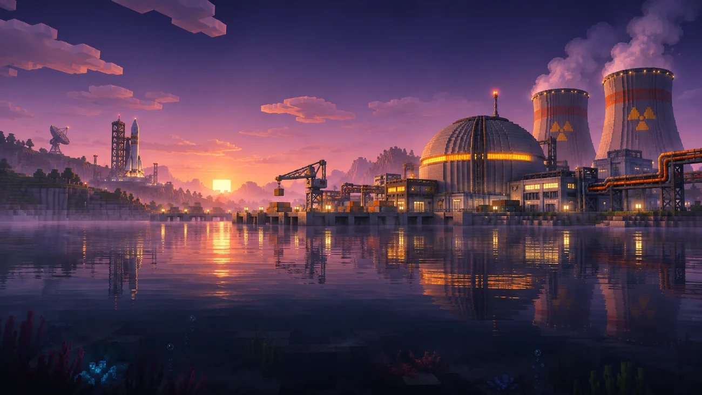

# NUCLEAR TECH: SECOND DAWN

**A new era of nuclear industry. / Новая эра ядерной промышленности.**

  
  
  
  

### [🌐 Official Website](https://bysally.github.io/NTSD/) · [🐛 Report a Bug](https://github.com/BySally/NTSD/issues/new/choose) · [💡 Suggestions](https://github.com/BySally/NTSD/issues/new/choose) · [📦 Releases](https://github.com/BySally/NTSD/releases)

**Public downloads are not available yet — NTSD is in alpha development.**  
**Публичная загрузка пока недоступна — NTSD находится в альфа-разработке.**

---

## О сборке · About the modpack

**RU** — **Nuclear Tech: Second Dawn (NTSD)** — независимая технологическая сборка Minecraft 1.20.1, которую развивает **BySally**. В её основе — **HBM NTM Continuum**, ядерные технологии, сложные промышленные системы, автоматизация и космические исследования. Квестовая прогрессия адаптирована из **Nuclear Tech: New Horizons** с сохранением указания оригинальных авторов.

**EN** — **Nuclear Tech: Second Dawn (NTSD)** is an independent Minecraft 1.20.1 technology modpack developed by **BySally**. Built around **HBM NTM Continuum**, it brings together nuclear engineering, large-scale industry, automation, and space exploration. Its quest progression adapts material from **Nuclear Tech: New Horizons**, with attribution to the original creators.

### Ключевые направления · Core features

| ☢️ Nuclear engineering | ⚙️ Industrial automation |
| --- | --- |
| Реакторы, топливные цепочки, радиация и сложные машины HBM. Reactors, fuel processing, radiation, and complex HBM machinery. | AE2, ProjectRed, CC: Tweaked и производственная логистика. AE2, ProjectRed, CC: Tweaked, and advanced factory logistics. |
| **🚀 Space exploration** | **📖 Quest progression** |
| Космические технологии HBM Continuum Space. Space technology powered by HBM Continuum Space. | Адаптированная система заданий NTNH. Quest content adapted from NTNH. |

## Атмосфера NTSD · Visual identity

<table>
<tr>
<td width="33%"></td>
<td width="33%"></td>
<td width="33%"></td>
</tr>
<tr>
<td align="center"><b>Nuclear industry</b></td>
<td align="center"><b>Industrial dawn</b></td>
<td align="center"><b>Space program</b></td>
</tr>
</table>

These are NTSD promotional concept illustrations, not gameplay screenshots. / Это концепт-иллюстрации проекта, а не скриншоты из игры.

## Скачать · Downloads

| Издание / Edition | Статус / Status | Ссылка / Link |
| --- | --- | --- |
| **Game Client / Клиент** | Alpha testing — not released | [Official download page](https://bysally.github.io/NTSD/#download) |
| **Dedicated Server / Сервер** | Alpha testing — not released | [Official download page](https://bysally.github.io/NTSD/#download) |

**Do not download files claiming to be official NTSD releases from unknown sources.**  
**Не скачивай файлы, выдаваемые за официальные релизы NTSD, из непроверенных источников.**

## Разработка и новости · Development & news

NTSD is currently being tested on **Minecraft 1.20.1 Forge**. Client and dedicated-server builds are maintained separately. Compatibility, performance, world generation, and existing saves are under review before the first public release.

Актуальные новости и информацию о готовности сборки смотри на [официальном сайте NTSD](https://bysally.github.io/NTSD/#updates). Изменения и публичные версии будут публиковаться в [GitHub Releases](https://github.com/BySally/NTSD/releases).

## Сообщество · Community

Found a crash, broken recipe, or incompatibility? Please include the build version, reproduction steps, and relevant logs; remove any personal information from attachments.

Нашёл ошибку? Укажи версию сборки, шаги для повторения, приложи логи и удали из них персональные данные.

- [🐛 Сообщить об ошибке / Report a bug](https://github.com/BySally/NTSD/issues/new/choose)
- [💡 Предложить улучшение / Suggest a feature](https://github.com/BySally/NTSD/issues/new/choose)
- [📋 Все обращения / Browse issues](https://github.com/BySally/NTSD/issues)

## Авторство и благодарности · Credits

**NTSD creator & maintainer:** [**BySally**](https://github.com/BySally)

**Technical foundation:** [HBM Nuclear Tech Mod: Continuum](https://www.curseforge.com/minecraft/mc-mods/ntm-continuum) and its creators.

**Adapted questbook and parts of world generation:** [Nuclear Tech: New Horizons (NTNH)](https://github.com/NTNewHorizons/NTNH), **Bufka2011** and the NTNH contributors. Thanks to Bufka2011 for permission to adapt his work with attribution and a link to the original.

All third-party mods retain their own licenses. NTNH-derived content remains subject to applicable license terms, including CC BY-NC-SA 4.0 where relevant. AI-assisted NTSD visuals are not automatically claimed as exclusively copyrighted works.

Подробнее: [CREDITS.md](CREDITS.md) · [LICENSE_NOTICE.md](LICENSE_NOTICE.md).

---

<b>Для разработчиков · Maintainer documentation</b>

This repository primarily hosts the official **NTSD website**, not a complete public modpack distribution.

- [Website deployment and updates](docs/DEPLOYMENT.md)
- [Website source](index.html)
- [Site settings](site-config.js)
- [Bug report templates](.github/ISSUE_TEMPLATE)
- [GitHub Pages](https://github.com/BySally/NTSD/settings/pages)

**Created by BySally · Nuclear Tech: Second Dawn**

*Independent, unofficial Minecraft modpack. Not affiliated with Mojang or Microsoft.*

